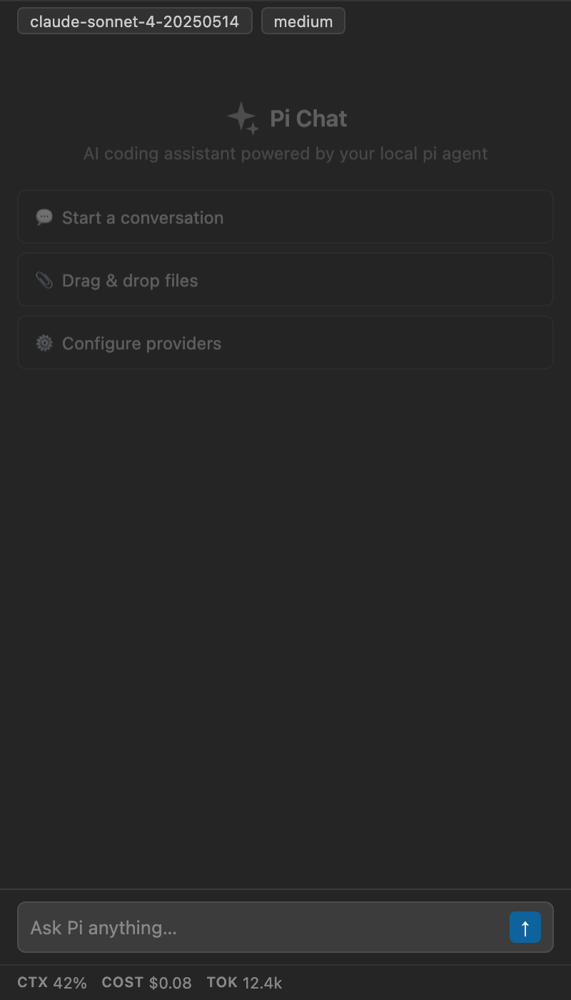
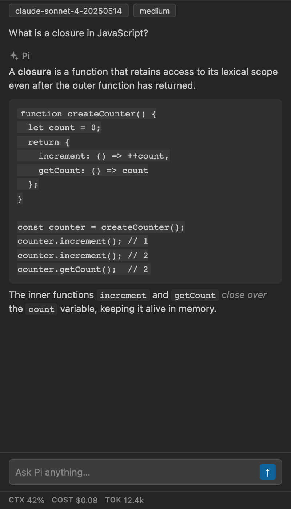
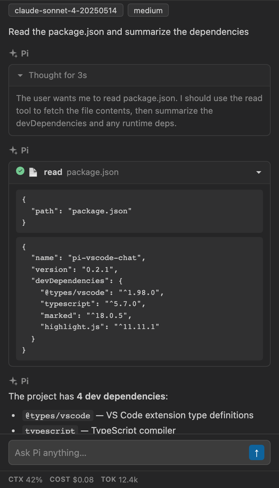
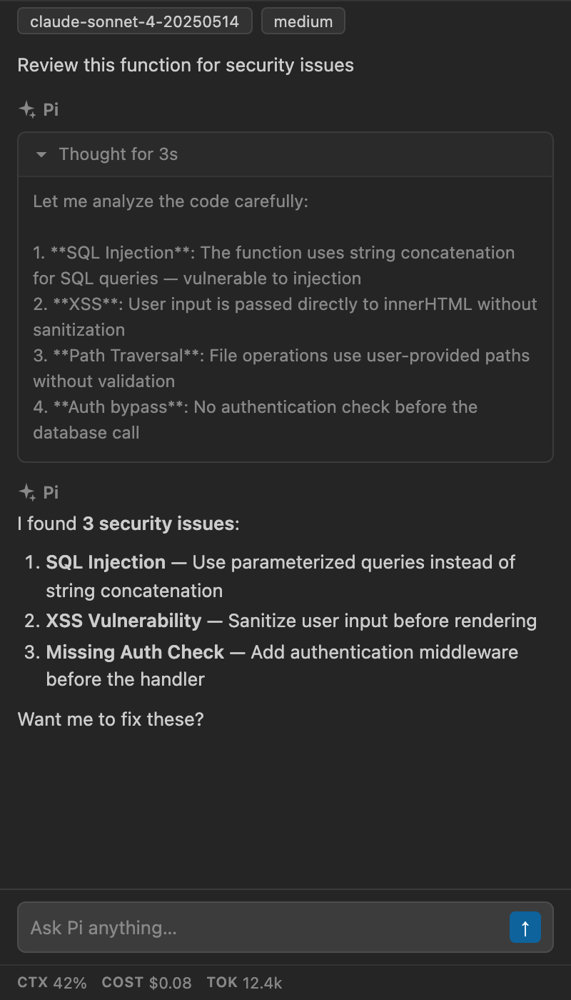
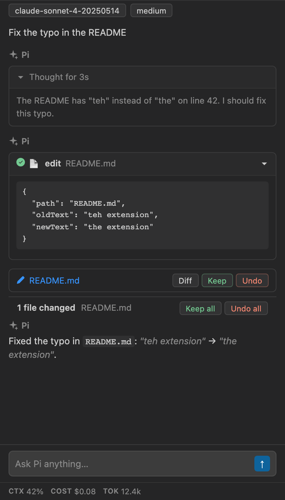
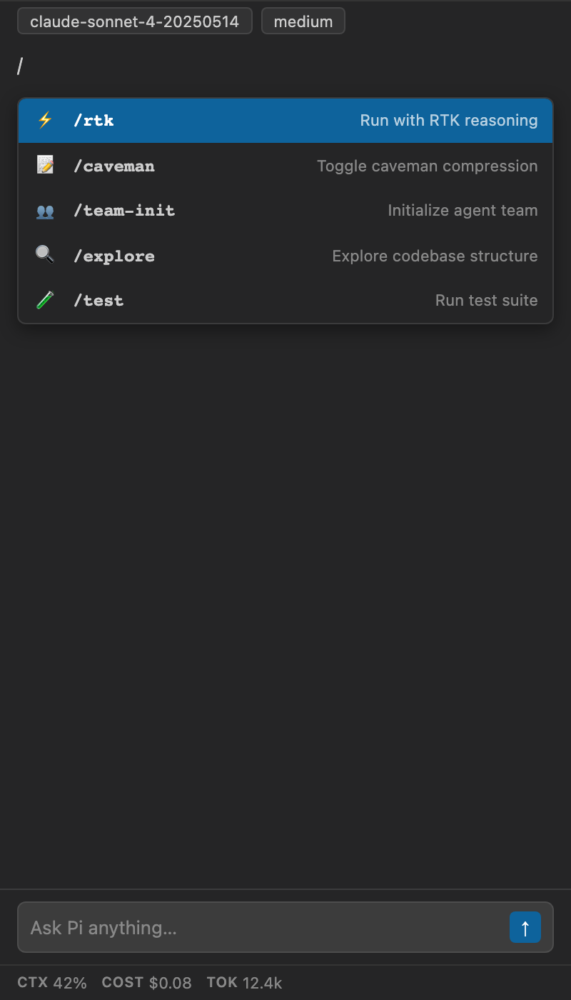
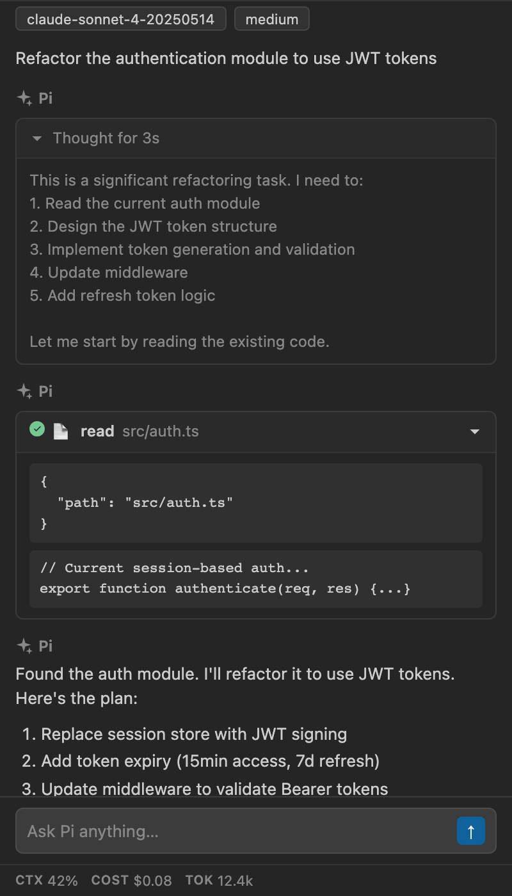
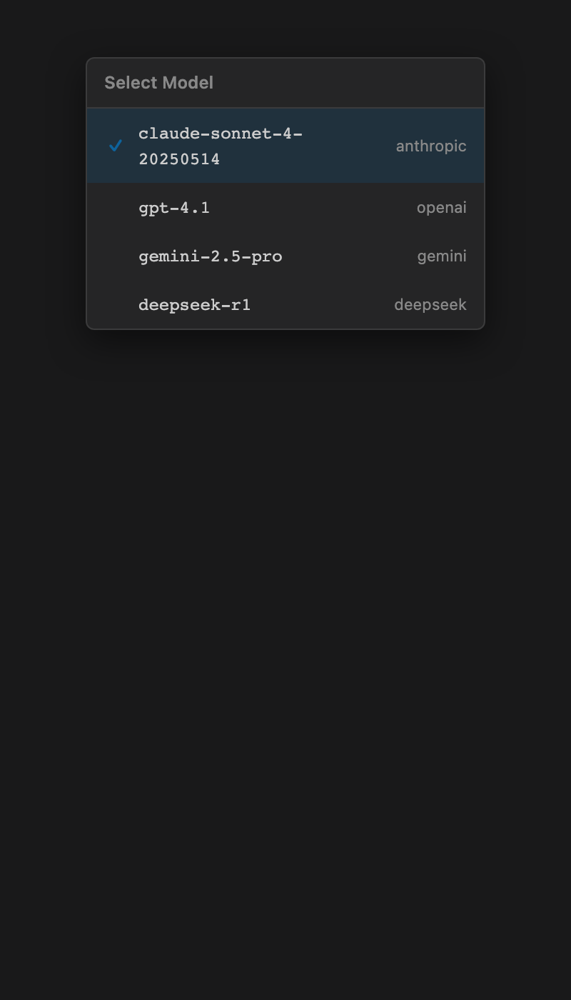

# Pi Chat for VS Code

[](https://marketplace.visualstudio.com/items?itemName=iqbalabiyoga.pi-vscode-chat)
[](https://opensource.org/licenses/MIT)
[](https://code.visualstudio.com/)

**Pi Chat** brings your local [pi coding agent](https://github.com/badlogic/pi-mono) into VS Code as a Copilot-style chat sidebar — with **all** pi extensions, skills, providers and multi-agent tooling working out of the box.

> ⚡ The extension is a **UI + RPC bridge layer** — it spawns the `pi` binary installed on your host (`pi --mode rpc`) and talks JSONL over stdin/stdout. It embeds no agent SDK; everything configured in `~/.pi/` (extensions, skills, multi-agent teams, providers) works automatically.

---

## Installation

### From Marketplace (recommended)

1. Open VS Code → **Extensions** (`Cmd+Shift+X`)
2. Search for **"Pi Chat"**
3. Click **Install**

Or install via command line:

```bash
code --install-extension iqbalabiyoga.pi-vscode-chat
```

### From VSIX

1. Download the latest `.vsix` from [Releases](https://github.com/iqbalabiyoga/pi-vscode-chat/releases)
2. Install: `code --install-extension pi-vscode-chat-<version>.vsix`

### Prerequisites

- **pi CLI** — the extension requires the `pi` coding agent on your `PATH`. No pi? Run **`Pi: Install Dependencies`** from the Command Palette — a wizard checks your environment and installs bun + pi + recommended skills.
- **AI Provider Key** — set once with `pi /login` in any terminal (or edit `~/.pi/auth.json` directly).

---

## Screenshots

| Welcome | Chat with Code | Tool Usage |
|:---:|:---:|:---:|
|  |  |  |

| Thinking Blocks | Edit Tracking | Slash Commands |
|:---:|:---:|:---:|
|  |  |  |

| Full Workflow | Model Switcher |
|:---:|:---:|
|  |  |

---

## Features

- **Lightweight & Host-Powered** — depends on the `pi` CLI installed on your machine (`~/.pi/` config, extensions, skills and multi-agent teams all work because your real pi runs). A built-in wizard checks dependencies and installs pi for you.
- **Secure Provider Auth** — guide to configure provider API keys via `pi /login` (host pi handles `~/.pi/auth.json`); no keys stored in the extension.
- **Interactive Skills Manager** — inspect and manage skills & extensions (`context-mode`, `pi-superpowers`, `pi-subagents`, `pi-agents-team`, `pi-caveman`, `pi-web-access`, `pi-mcp-adapter`) directly via Command Palette (`Pi: Manage Skills & Extensions`).
- **Visual Diff Badges & Inline View** — real-time `+Added / -Removed` line stats (e.g. `+18 / -3`) on file edits, side-by-side inline diffs, auto-generated unified patch fallbacks, and 1-click Keep / Undo actions.
- **Streaming chat** — real-time markdown rendering, syntax-highlighted code blocks, copy buttons, collapsible thinking (reasoning) blocks.
- **Steering** — keep typing while the agent runs. Enter queues a steering message, Esc aborts.
- **Slash commands** — `/` autocompletes every pi command, skill, prompt template on your machine (rtk, caveman, team-init, etc.).
- **`@` file search** — inline fuzzy file search: `@` + filename to reference workspace files.
- **Edit tracking** — every agent file edit gets Diff / Keep / Undo. A "Keep all / Undo all" changes bar lets you batch-accept or batch-revert edits from the current session.
  Review buttons appear in a file card below the tool output, even when the tool is collapsed. Expand the tool and its Changes section for an inline preview, or click Diff to open the VS Code diff editor. Repeated edits to a pending file share one review card; Keep accepts its current contents, and Undo restores the contents from before its pending changes (or removes a newly created file). Undo is available only while the original in-memory snapshot exists; edits loaded from a previous VS Code run cannot regain Keep / Undo from chat history alone.
- **Session management** — persistent JSONL sessions; browse and resume previous pi sessions per workspace. The chat header shows the current session name (or ID if unnamed); hover for the full name and ID. Names refresh after `/name` when provided by a host extension such as `pi-deepseek-theme`.
- **Live stats** — context usage %, session cost, token totals in the footer.
- **Model & thinking level** — QuickPick to switch models; cycle reasoning effort (off → minimal → low → medium → high → xhigh) from the toolbar.
- **Extension status chips** — pi extensions surface as interactive chips: toggle rtk on/off, change caveman compression level, open the agents-team panel (Init / Result / Stop).
- **Attachments** — image-aware file picker, clipboard paste, and Explorer/Finder drag & drop; removable thumbnails, image-only prompts, and images in live/restored chat history.
- **Selectable chat styles** — click **Style** to the right of **Keys** in the footer. Choose **Default** for VS Code theme colors (light, dark, and high-contrast), or **Custom** for tinted tool results and light blue code blocks. The choice is saved across chat sessions and webview reloads. No CDN assets. Strict Content Security Policy.

---

## Image input

1. Select a model that supports images using the model picker.
2. Click the paperclip to choose an image, drop one from Explorer/Finder, or focus the chat input and paste a copied screenshot with **Ctrl+V / Cmd+V**.
3. Optionally add text, then press Enter. Image-only prompts and steering messages are supported. Remove an attachment with its **✕** button.

Supported formats: **PNG, JPEG, GIF, WebP**. Limits: **4 images**, **4 MiB per image**, **12 MiB total**, **8000 pixels per side**, and **32 megapixels per image**. Resize or convert larger/unsupported images before attaching; individual AI providers may impose stricter limits. Images are not automatically resized.

The composer waits for attachment reads and RPC acceptance before clearing the draft. If Pi rejects a prompt, its text and images remain available for retry. Image input is blocked for text-only models. Extension slash commands cannot consume image attachments; use a regular prompt, skill, or prompt template instead.

Images are sent as base64 image blocks, not `@path` text. Ordinary file attachments and `@` autocomplete remain path references that the agent can read. Explorer resources retain their VS Code remote URI; clipboard and OS-drop images are read locally in the webview and passed to the extension host. Paste requires actual image clipboard data—if you copied a file icon/path rather than its pixels, use the file picker instead.

Accepted images are stored in Pi's session history and restored with the conversation. Unsent attachments stay in memory and are cleared when changing sessions or reloading the webview. No temporary image files or separate upload service are used.

---

## Commands

| Command | Keybinding | Description |
|---|---|---|
| `Pi: Configure AI Provider & Keys` | — | Guide to configure provider keys via `pi /login` (host pi handles `~/.pi/auth.json`) |
| `Pi: Manage Skills & Extensions` | — | Inspect & install pi skills (`context-mode`, `pi-subagents`, etc.) |
| `Pi: Check Dependencies` | — | Audit pi binary, skills, and build dependencies |
| `Pi: Install Dependencies` | — | Run the dependency wizard (installs bun, pi, and skills) |
| `Pi: New Session` | — | Start a fresh conversation |
| `Pi: Select Model` | — | Pick model/provider from available options |
| `Pi: Accept Edit` | — | Keep a pending edit |
| `Pi: Reject Edit` | — | Revert a pending edit |
| `Pi: Abort Current Task` | — | Stop the currently running agent |
| `Pi Chat: Ask About Selection` | Editor context menu | Send selected code to chat with file path and line numbers |

---

## Privacy & Data Handling

Understanding how data flows through Pi Chat is important — especially since the extension connects to AI providers.

### Data flow

```
Your code / files / images
    │
    ▼
VS Code Extension Host ◄────────────►  pi --mode rpc (child process)
    │                                        │
    │                                   [your local machine]
    │                                        │
    ▼                                        ▼
Webview (sidebar UI)                  AI provider
(no network access,                     (any provider configured in pi)
 only local webview)                    │
                                        ▼
                                  External API servers
```

### What data is sent to AI providers

Everything you type, attach, or that pi reads during execution is sent through pi to whichever AI provider you've configured:

- **Chat messages** — your prompts, questions, code requests
- **Attached files** — files selected via file picker, or dropped/pasted into the chat
- **Source code** — pi's `read`, `grep`, `find`, `ls` tools read workspace files. pi passes relevant excerpts to the AI provider
- **Images** — selected from the file picker, pasted from the clipboard, or dropped into the webview (converted to base64 and sent with your prompt)
- **Workspace structure** — file paths, directory names, project scaffolding

### What stays local

- **Edit snapshots** — file snapshots for accept/revert are stored in extension memory only
- **Session list** — session files are read from `~/.pi/agent/sessions/*.jsonl` and their titles displayed; the raw session files are never sent externally
- **VS Code state** — only the selected chat style is persisted via `vscode.setState()`. Chat history, including accepted image blocks, is restored from Pi sessions; unsent image drafts are not saved to VS Code state.

### Security recommendations

1. **Do not paste API keys, passwords, or tokens into chat prompts** — they will be sent to the AI provider
2. **Review your provider's data policy** — pi sends code to whatever provider you configure (each provider has its own data usage policy)
3. **Use `piChat.extraEnv` for credentials** — pass API keys through env vars instead of in prompts
4. **Clear sessions** regularly — `Pi: New Session` starts fresh; old sessions remain on disk under `~/.pi/agent/sessions/`
5. **Be mindful of drag & drop** — files dropped from Finder are automatically read and their contents may be sent to the AI provider
6. **Check `piChat.piPath`** — only install pi from trusted sources (`@earendil-works/pi-coding-agent` on npm)

---

## Architecture

```
┌──────────────────────────────────────────────────┐
│  VS Code Extension Host                          │
│  ┌──────────────────────┐  ┌──────────────────┐  │
│  │  PiRpcClient          │  │  EditManager      │  │
│  │  ─ child process mgr  │  │  ─ snapshot/revert│  │
│  │  ─ JSONL stdin/stdout │  │  ─ diff tracking  │  │
│  └──────────┬───────────┘  └──────────────────┘  │
│             │                                     │
│  ┌──────────▼───────────┐                        │
│  │  ChatSidebarProvider   │                      │
│  │  ─ WebviewViewProvider│                      │
│  │  ─ event bridge       │                       │
│  │  ─ message routing    │                       │
│  └──────────┬───────────┘                        │
│             │ postMessage / onDidReceiveMessage   │
└─────────────┼────────────────────────────────────┘
              │
              ▼
┌────────────────────────────┐
│  Webview (sidebar)          │
│  ─ vanilla JS, no framework │
│  ─ marked + highlight.js    │
│  ─ CSP: local scripts only  │
│  ─ all colors from theme    │
└────────────────────────────┘
              ▲
              │ JSONL over stdin/stdout
              │
┌─────────────────────────────┐
│  pi --mode rpc (child)       │
│  ─ all extensions & skills   │
│  ─ configured AI provider    │
│  ─ multi-agent, subagents    │
│  ─ sessions, filesystem, etc │
└─────────────────────────────┘
```

### Key design decisions

- **No agent SDK embedded** — the extension is pure UI + RPC bridge. Everything pi-related comes from the real binary
- **Process isolation** — a pi crash cannot take down VS Code (separate OS process)
- **Sessions persist by default** — the child process writes session files to `~/.pi/agent/sessions/`; history loads through RPC, respecting branches and compaction
- **CSP-locked webview** — no inline scripts, no CDN, `default-src 'none'`. All webview assets (CSS, JS, vendor bundle) ship with the extension
- **Minimal env exposure** — only `PATH`, `HOME`, `USER`, `TERM` are forwarded to the child process by default (not the full `process.env`); opt-in via `piChat.extraEnv`

---

## Development

```bash
bun install                    # Install build deps (marked, highlight.js, TypeScript)
bun run compile                # Full build: vendor + webview + extension + type check
bun run build                  # Extension bundle only (fast iteration)
bun run build:vendor           # Vendor bundle only (marked + hljs)
bun run build:webview          # Bundle media/main.js + media/chat/* for the webview
bun run watch                  # tsc -watch for type checking only
bun run test                   # Unit/bridge regression tests (no Pi/provider needed)
bun run test:webview           # Real webview tests via browser-harness + Chrome (mocked VS Code API)
```

Press **F5** to launch the Extension Development Host (`.vscode/launch.json` runs `npm: compile` first).

### Project structure

```
src/
├── extension.ts              # Activation, command registration, dependency check
├── piRpcClient.ts            # Child process manager, JSONL protocol
├── chatSidebarProvider.ts    # WebviewViewProvider, event bridge
├── editManager.ts            # File snapshots, accept/revert tracking
├── imageAttachments.ts       # Image format/MIME, dimensions and payload limits
├── types.ts                  # All message shapes (RPC, webview, events)
media/
├── main.js                   # Webview bootstrap and host-message routing
├── chat/                     # ES modules; controller-local state, explicit dependencies
│   ├── conversation.js       # Messages, thinking and streaming lifecycle
│   ├── history.js            # Restored conversation rendering
│   ├── markdown.js           # Markdown, highlighting, file links and render throttling
│   ├── tools.js              # Tool cards, diffs and edit review actions
│   ├── composer.js           # Draft, submission acknowledgment and input state
│   ├── autocomplete.js       # @ files and / commands
│   ├── attachments.js        # Attachment validation, previews and pending reads
│   ├── drop-input.js         # Clipboard and drag/drop event handling
│   ├── panels.js             # Team monitor, status chips, widgets, queue and stats
│   ├── dialogs.js            # Extension UI dialogs
│   ├── shell.js              # Style, model, session header and toolbar
│   └── dom.js, icons.js, images.js  # Shared helpers
├── main.bundle.js            # Generated standalone webview script (do not edit)
├── style.css                 # Theme-native styles (--vscode-* tokens)
├── vendor-entry.js           # Entry point for vendor bundle
├── vendor.js                 # Bundled marked + highlight.js (built)
```

### READ THIS

- The `out/extension.js` entry point is produced by **bun build**, not `tsc`. `tsc` only type-checks. If changes don't take effect, rebuild the bun bundle.
- Edit frontend source in `media/main.js` or `media/chat/`, then run **`bun run build:webview`** (or `compile`). The host loads `media/main.bundle.js`, a single IIFE using the existing nonce-based CSP. The bundle and its source map are generated/ignored; packaging includes the bundle, not the source modules. `test:webview` rebuilds before testing the shipped script.
- Each controller owns its feature state. `main.js` acquires the VS Code API once, connects controllers, and routes host events. Only conversation/streaming state is shared between conversation rendering and the composer; feature modules do not depend on globals from another module.
- All message shapes across all three boundaries (RPC ↔ extension host ↔ webview) are defined in `src/types.ts` — single source of truth.
- The webview has zero npm dependencies at runtime — all JS ships with the extension. No CDN. Strict CSP.
- Colors come from `--vscode-*` CSS variables. No hard-coded palette.

---

## Troubleshooting

| Symptom | Likely cause | Fix |
|---|---|---|
| "pi not found" | pi binary not on PATH | Run **Pi: Install Dependencies** or `bun add -g @earendil-works/pi-coding-agent`. Check `piChat.piPath` setting |
| "Failed to start pi process" | Wrong path or permission | Verify `piChat.piPath` points to a valid binary. Check VS Code Developer Tools console for details |
| "No models available" | No AI provider configured | pi needs at least one provider. Run `pi /login` in the terminal, or set provider API keys in `piChat.extraEnv` |
| Skills not loading | Global install missing | `bun pm ls -g` to check; `bun add -g <name>` to install. Restart VS Code |
| Webview blank / not loading | Vendor bundle issue | Rebuild: `bun run build:vendor`. Check Extension Host logs |
| Chat history missing after reload | State cleared | Sessions are persisted in `~/.pi/agent/sessions/` — click **History** button to resume one |
| "Compacting conversation" | Context window full | Normal — pi compacts the conversation to fit. The agent pauses briefly |
| Extension commands not found | Extension not activated | Open the Pi Chat sidebar to activate, or run any Pi command from the palette |

---

## License

MIT — see [LICENSE](LICENSE) for details.

---

## Publishing

```bash
bun run compile                    # full build
vsce publish --no-dependencies     # publishes to Marketplace
```

See [EXTENSION.md](EXTENSION.md) for the full publishing lifecycle, version management, and CI/CD setup.

---

*Built with [pi](https://github.com/badlogic/pi-mono) — the open-source coding agent for your terminal, now in your editor.*
